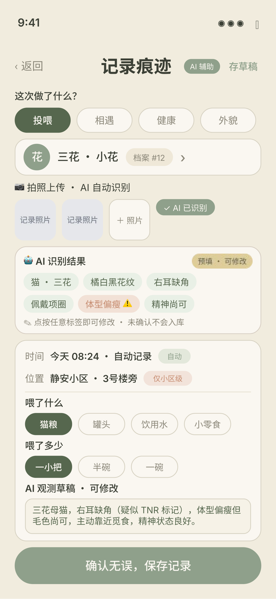

# 爪迹 PawTrace 🐾

> 流浪猫长期观测移动应用 —— 一套代码跑 H5 / 微信小程序 / Android 三端的全栈项目，集成多模态大模型辅助流浪猫科学观测。

「个体档案 + 痕迹记录 + 协作共护」：为校园 / 社区流浪猫建立可长期追踪的个体档案，观测者通过打卡记录痕迹，多人协作共同守护同一只猫。

## ✨ 核心特性

- **多模态大模型识别**：打卡拍照后自动提取猫咪毛色、花纹、体态特征，预填记录表单，降低观测门槛
- **AI 建档去重**：提取建档照片外观描述，与已有档案做相似度比对，返回疑似重复个体供确认，避免重复建档
- **跨端一致体验**：uni-app 一套代码编译到 H5、微信小程序、Android 三端
- **协作共护**：档案沉淀 + 地图点位 + 多人协作空间
- **隐私优先设计**：坐标街区级模糊后再上传、照片剥离 EXIF 信息，服务端仅存模糊坐标

## 📱 应用界面

**AI 辅助打卡（记录痕迹页）**——拍照上传后多模态大模型自动识别猫咪特征，预填标签与观测草稿，人工确认后才入库：

<p align="center">
  
</p>

> 图中可见的完整链路：选择行为类型（投喂/相遇/健康/外貌）→ 关联个体档案 → 拍照上传触发 AI 识别 → 特征标签预填（可修改）→ 自动生成观测草稿 → 确认保存。位置仅显示到小区级（隐私模糊化）。

## 🛠 技术栈

| 端 | 技术 |
|---|---|
| 客户端 | Vue 3 · uni-app · TypeScript |
| 服务端 | NestJS · TypeScript · 全局守卫统一鉴权 |
| 数据 | Prisma ORM · MySQL |
| AI | 多模态大模型（OpenAI 兼容接口，密钥仅存后端） |
| 地图 | 腾讯位置服务 |

## 📐 架构

```
┌─────────────────────────────┐
│   uni-app 客户端（三端）      │  H5 / 微信小程序 / Android
└──────────────┬──────────────┘
               │ REST API
┌──────────────▼──────────────┐
│   NestJS 服务端              │  用户 / 档案 / 记录 / 协作空间 / AI 处理
│   · JWT 全局守卫鉴权          │
│   · AI 密钥仅存后端           │
└──────┬───────────────┬──────┘
       │               │
┌──────▼──────┐  ┌─────▼──────────────┐
│  MySQL      │  │  多模态大模型 API    │
│  (Prisma)   │  │  特征提取 / 相似度   │
└─────────────┘  └────────────────────┘
```

## 🚀 快速开始

### 服务端（pawtrace-server）

```bash
cd pawtrace-server
npm install
cp .env.example .env   # 填入 MySQL 密码与 AI API Key
npm run prisma:migrate
npm run start:dev      # 默认 http://localhost:3000
```

> `.env` 永远不进 git。AI 模型兼容 OpenAI 接口：智谱填 `glm-4v-flash`，OpenAI 填 `gpt-4o-mini` 等。

### 客户端（pawtrace-app）

使用 HBuilderX 导入 `pawtrace-app` 目录，或使用 uni-app CLI 运行到 H5 / 微信小程序 / Android 基座。

## 🔒 隐私设计

- 客户端对定位坐标做**街区级模糊**后再上传，服务端仅存模糊坐标
- 照片上传前**剥离 EXIF 信息**（含拍摄位置）
- 第三方 AI 密钥只存服务端，绝不下发到客户端

## 📁 目录结构

```
pawtrace/
├── pawtrace-app/      # uni-app 客户端（H5 / 小程序 / Android）
├── pawtrace-server/   # NestJS 服务端 + Prisma
├── shared/            # 前后端共享类型定义
└── docs/              # API 契约
```
