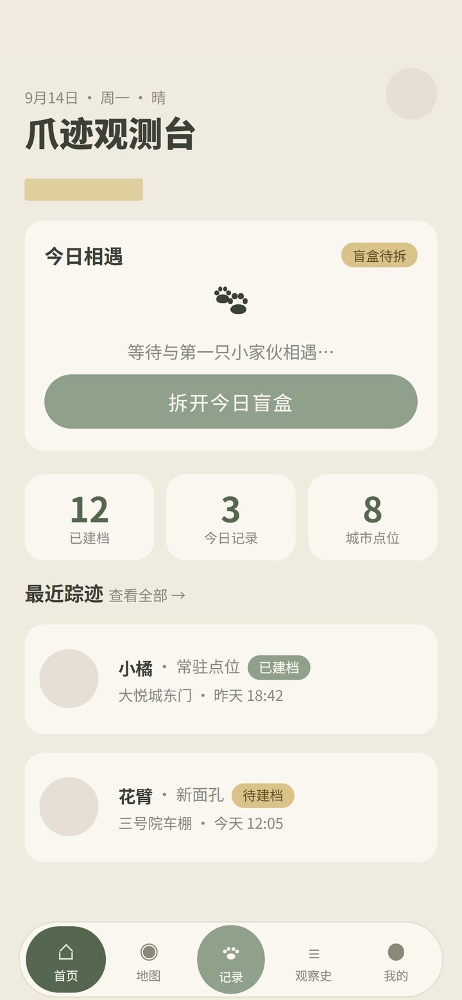
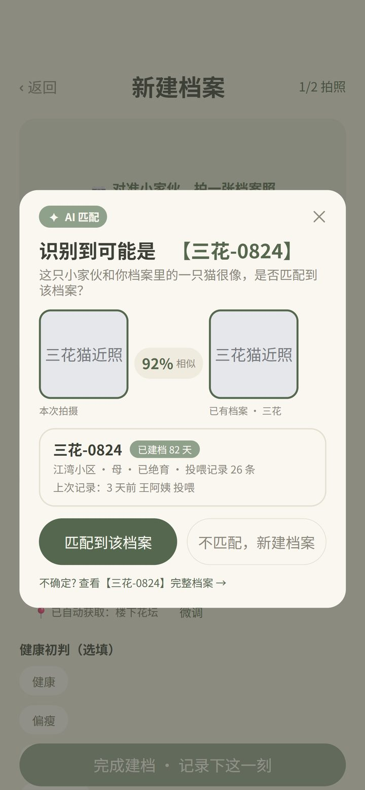
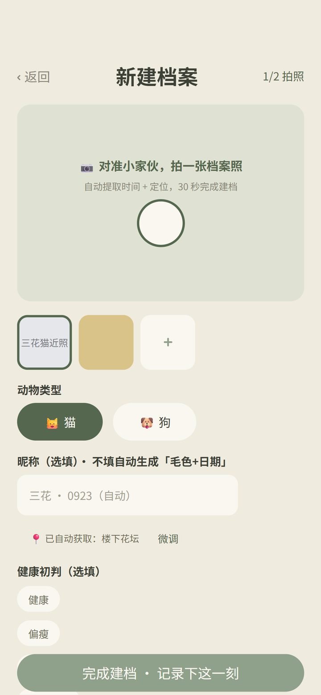
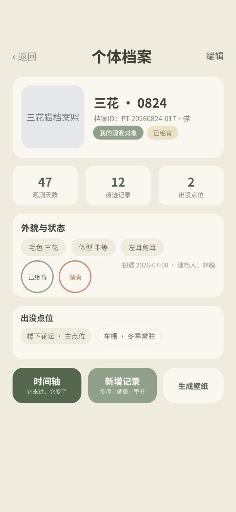
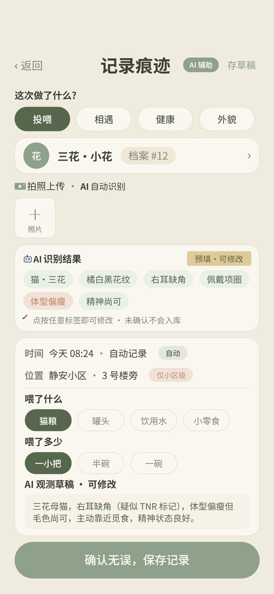
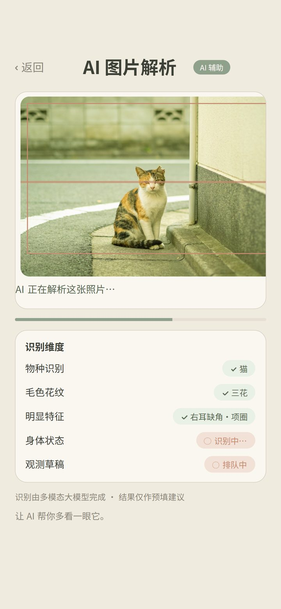
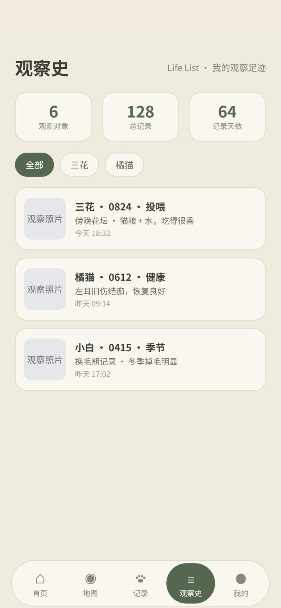
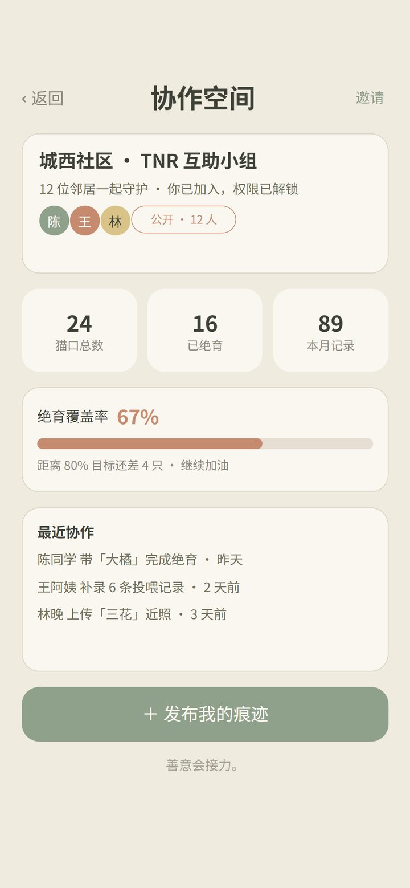

# 爪迹 PawTrace 🐾

> 流浪猫长期观测移动应用 —— 一套代码跑 H5 / 微信小程序 / Android 三端的全栈项目，集成多模态大模型辅助流浪猫科学观测。

「个体档案 + 痕迹记录 + 协作共护」：为校园 / 社区流浪猫建立可长期追踪的个体档案，观测者通过打卡记录痕迹，多人协作共同守护同一只猫。

## ✨ 核心特性

- **多模态大模型识别**：打卡拍照后自动提取猫咪毛色、花纹、体态特征，预填记录表单，降低观测门槛
- **AI 建档去重**：提取建档照片外观描述，与已有档案做相似度比对，返回疑似重复个体供确认，避免重复建档
- **跨端一致体验**：uni-app 一套代码编译到 H5、微信小程序、Android 三端
- **协作共护**：档案沉淀 + 地图点位 + 多人协作空间
- **隐私优先设计**：坐标街区级模糊后再上传、照片剥离 EXIF 信息，服务端仅存模糊坐标

## 📱 应用界面

以下均为真机运行截图（Android 端）。

<h3>核心链路：地图发现 → AI 建档 → 记录痕迹</h3>

<table>
  <tr>
    <td align="center">
      <br />
      <sub><b>① 首页观测台</b><br />地图点位 + 发现附近的猫</sub>
    </td>
    <td align="center">
      <br />
      <sub><b>② AI 识别</b><br />拍照后自动提取毛色 / 花纹 / 体态</sub>
    </td>
    <td align="center">
      <br />
      <sub><b>③ 30 秒建档</b><br />识别结果预填表单，人工确认后入库</sub>
    </td>
  </tr>
  <tr>
    <td align="center">
      <br />
      <sub><b>④ 个体档案</b><br />生命周期状态 + 关联点位</sub>
    </td>
    <td align="center">
      <br />
      <sub><b>⑤ 痕迹记录</b><br />选择行为类型并关联个体档案</sub>
    </td>
    <td align="center">
      <br />
      <sub><b>⑥ AI 解析</b><br />特征标签预填 + 观测草稿自动生成</sub>
    </td>
  </tr>
</table>

<h3>配套能力</h3>

<table>
  <tr>
    <td align="center">
      <br />
      <sub><b>科普卡</b><br />识别完成后附带科学观察提示</sub>
    </td>
    <td align="center">
      <br />
      <sub><b>观察史</b><br />按时间轴沉淀的历史记录</sub>
    </td>
    <td align="center">
      <br />
      <sub><b>协作空间</b><br />多人共护同一只猫的看板</sub>
    </td>
  </tr>
</table>

> **AI 链路全貌**：拍照上传 → 多模态大模型提取特征 → 结构化结果预填表单 → 用户确认/修改 → 入库。AI 只做辅助，最终内容由人确认；同一次识别还会与已有档案做外观相似度比对，返回疑似重复个体，避免重复建档。地图位置仅显示到小区级（坐标街区级模糊化后上传）。

## 🛠 技术栈

| 端 | 技术 |
|---|---|
| 客户端 | Vue 3 · uni-app · TypeScript |
| 服务端 | NestJS · TypeScript · 全局守卫统一鉴权 |
| 数据 | Prisma ORM · MySQL |
| AI | 多模态大模型（OpenAI 兼容接口，密钥仅存后端） |
| 地图 | 腾讯位置服务 |

## 📐 架构

```
┌─────────────────────────────┐
│   uni-app 客户端（三端）      │  H5 / 微信小程序 / Android
└──────────────┬──────────────┘
               │ REST API
┌──────────────▼──────────────┐
│   NestJS 服务端              │  用户 / 档案 / 记录 / 协作空间 / AI 处理
│   · JWT 全局守卫鉴权          │
│   · AI 密钥仅存后端           │
└──────┬───────────────┬──────┘
       │               │
┌──────▼──────┐  ┌─────▼──────────────┐
│  MySQL      │  │  多模态大模型 API    │
│  (Prisma)   │  │  特征提取 / 相似度   │
└─────────────┘  └────────────────────┘
```

## 🚀 快速开始

### 服务端（pawtrace-server）

```bash
cd pawtrace-server
npm install
cp .env.example .env   # 填入 MySQL 密码与 AI API Key
npm run prisma:migrate
npm run start:dev      # 默认 http://localhost:3000
```

> `.env` 永远不进 git。AI 模型兼容 OpenAI 接口：智谱填 `glm-4v-flash`，OpenAI 填 `gpt-4o-mini` 等。

### 客户端（pawtrace-app）

使用 HBuilderX 导入 `pawtrace-app` 目录，或使用 uni-app CLI 运行到 H5 / 微信小程序 / Android 基座。

## 🔒 隐私设计

- 客户端对定位坐标做**街区级模糊**后再上传，服务端仅存模糊坐标
- 照片上传前**剥离 EXIF 信息**（含拍摄位置）
- 第三方 AI 密钥只存服务端，绝不下发到客户端

## 📁 目录结构

```
pawtrace/
├── pawtrace-app/      # uni-app 客户端（H5 / 小程序 / Android）
├── pawtrace-server/   # NestJS 服务端 + Prisma
├── shared/            # 前后端共享类型定义
└── docs/              # API 契约
```
